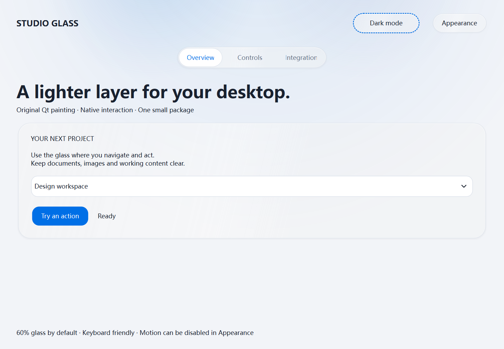
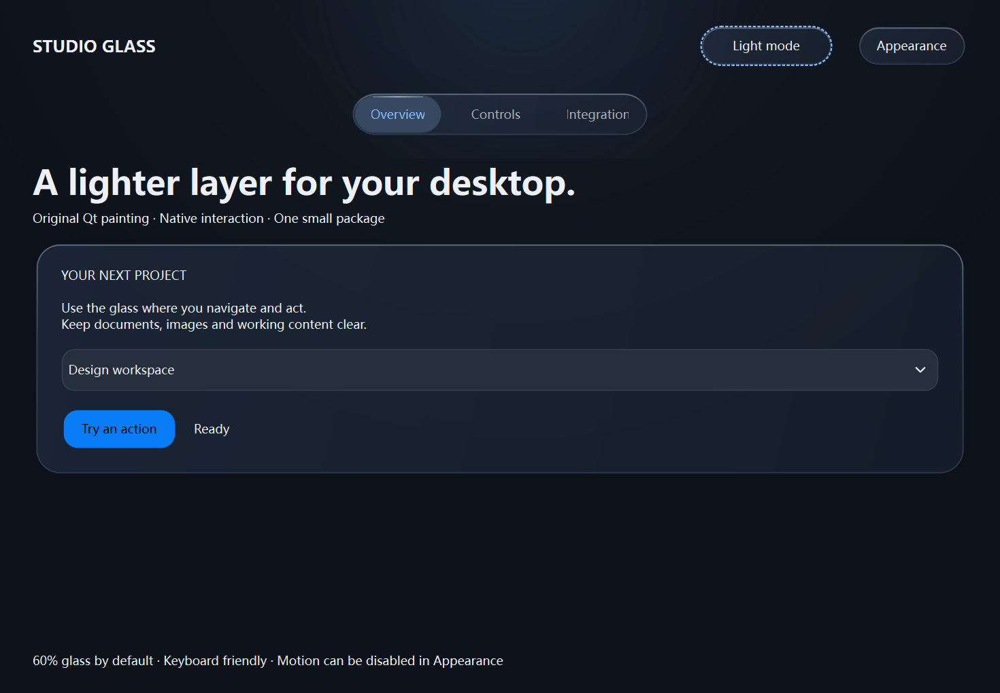

# Studio Glass Qt

[English](README.md) · [接入/API](docs/INTEGRATION.md) · [验证记录](docs/VALIDATION.md)

这是从我们自己的桌面界面中整理出的 **Qt 6 Widgets 玻璃风格组件库**。支持 PyQt6 和 PySide6，保留清淡蓝灰光层、半透明底材、细高光、按钮按压回弹和连续导航滑移。默认透明度为你喜欢的 **60%**。

它可以逐个控件接入其他项目，不需要复制原来的整套软件；不包含原应用、模型、数据、业务引擎、私有配置或PyGlass代码。




图片是中性演示窗口的控件渲染快照；实际交互、离屏自动检查和跨平台结果分别记录在[验证记录](docs/VALIDATION.md)。

## 下载和打开

要求 Python 3.10+，任选一个Qt绑定。**尚未发布PyPI**，不能直接用 `pip install studio-glass-qt` 从PyPI获取。

`[pyside6]`只安装官方Essentials基础模块；Python低于3.12时排除6.12.0，因为Linux CI的纯Qt探针复现了引用计数异常。请通过本库extra安装，具体范围和证据见验证记录。

Windows PowerShell：

```powershell
git clone https://github.com/lanlanyangyang/studio-glass-qt.git
Set-Location studio-glass-qt
py -m venv .venv
& .\.venv\Scripts\python.exe -m pip install ".[pyqt6]"
& .\.venv\Scripts\python.exe -m studioglass
```

也可以下载GitHub ZIP并解压，然后在解压目录运行后三条命令。使用PySide6时将 `[pyqt6]` 改成 `[pyside6]`。Linux/macOS虚拟环境解释器通常为 `.venv/bin/python`。

## 用进你自己的项目

```python
from studioglass import ThemeController, GlassSurface, GlassButton
from studioglass.qt import QtWidgets as W

app = W.QApplication([])
window = GlassSurface()
theme = ThemeController(window, mode="light", transparency=60)
layout = W.QVBoxLayout(window)
button = GlassButton("开始", variant="primary")
button.clicked.connect(lambda: print("这里连接原有业务"))
layout.addWidget(button)
window.resize(420, 240)
window.show()
app.exec()
```

已有 `QWidget/QMainWindow` 可直接作为控制器宿主，不必替换窗口。按钮、下拉和导航继续使用标准Qt信号，不延迟任务。完整示例见 `examples/minimal.py`、`examples/existing_window.py`，运行 `python -m studioglass` 查看交互画廊。

| 可调项 | 用法 |
|---|---|
| 浅色/深色/跟随系统 | `theme.configure(mode="light" / "dark" / "system")` |
| 玻璃透明度 | `theme.configure(transparency=0..60)`，默认60 |
| 关闭自定义动效 | `theme.configure(motion=False)` |
| 强调色 | `theme.configure(accent="#236ad3")`，传None恢复默认 |
| 记忆外观 | 宿主用QSettings或自己的配置保存，库不读写文件 |

Qt绑定从已导入的绑定选择；未导入时优先PyQt6，再选PySide6。可在导入前设置环境变量 `STUDIOGLASS_QT_API` 为 `pyqt6` 或 `pyside6`；同一进程禁止混用。

## 适配边界

- 面向Qt6 Widgets，提供普通窗口、QMainWindow、逐控件接入方式。没有新增其他UI框架。
- 使用宿主字体，保留真实QIcon、文案、助记符、禁用、焦点、鼠标和键盘行为；中文与DPI由Qt处理。缓存包括尺寸、主题、透明度和DPR。
- 外观只作用于宿主控件树，不设置应用全局样式或全局动画开关。不修改图像像素，不捕获桌面或前景控件。
- 这是Qt绘制的玻璃观感，**不是真实光学折射或系统级桌面毛玻璃，也不是iOS原生UI复刻**。背景越单调，透明感变化越细微。
- 不自动检测系统减少动态效果设置；需要宿主设置 `motion=False`。原生文件对话框、窗口边框保持系统行为。
- 主题直接更新配色，不缓存整窗截图过渡。表格、树、菜单栏及其他第三方组件继续由宿主处理；不承诺全系统所有版本均已通过。

## 许可与贡献

本库原创代码采用MIT。运行时Qt及绑定保留各自许可：PyQt6为GPLv3或商业许可，PySide6为LGPLv3/GPLv3或商业许可；不能用本库MIT替代依赖许可。详见[依赖说明](THIRD_PARTY_NOTICES.md)。

提交问题时提供操作系统、Python、绑定/Qt版本、缩放比例、最小复现代码；不要上传私人数据或凭据。欢迎在现有组件范围内改进兼容性、键盘和视觉问题。
